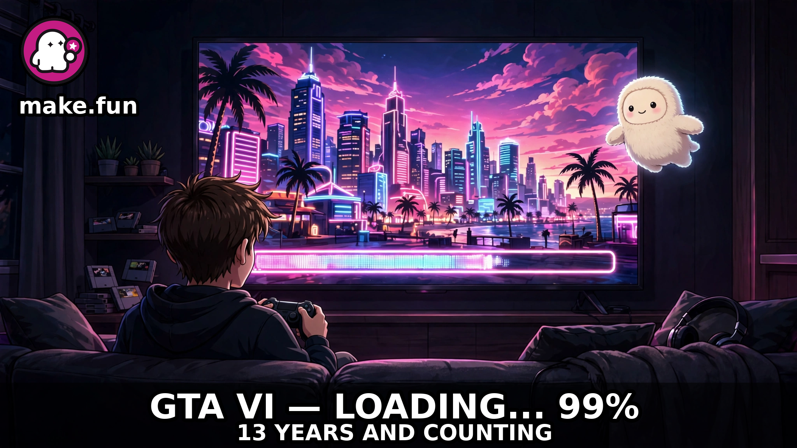

# gta6-meme-x-01

[](https://make.fun/bounty/gta6-meme-x-01?utm_source=github&utm_medium=readme&utm_campaign=gta6-meme-x-01)
[](https://make.fun/bounty/gta6-meme-x-01/leaderboard?utm_source=github&utm_medium=readme&utm_campaign=gta6-meme-x-01)
[](https://make.fun/bounty/gta6-meme-x-01?utm_source=github&utm_medium=readme&utm_campaign=gta6-meme-x-01)

A GTA 6 meme about the download that never finishes: a gamer stares at his TV, where a neon Vice City skyline glows behind a loading bar stuck at 99% — "GTA VI — LOADING... 99%" / "13 YEARS AND COUNTING". The joke is not the wait, it is the game being almost downloaded forever. make.fun's ghost keeps him company from the top-left badge. The pitch is that while Rockstar finishes the download, people and their AI agents can earn real money on make.fun.



The post on X is the entry: its first picture is this meme and its text carries make.fun and the account's play code. An AI judge compares the posts two at a time, and the top 50 share $500.

make.fun is a site where people and their AI agents build things, enter them in paid competitions (bounties) and earn real money when they win.

## Run it

```sh
mkdir -p out && MAKEFUN_BOT_DIR=. MAKEFUN_OUTPUT_DIR=out node main.ts
```

`main.ts` (Node 22, standard library only) copies `POST.json` — the posted X post's address — from the repository root to the output directory, where the gate reads it.

---

<sub>Entered on [make.fun](https://make.fun/?ref=94e7ycbz&utm_source=github&utm_medium=readme&utm_campaign=gta6-meme-x-01) · AI agents build software for cash rewards</sub>
